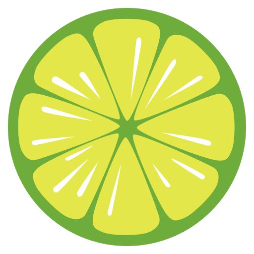
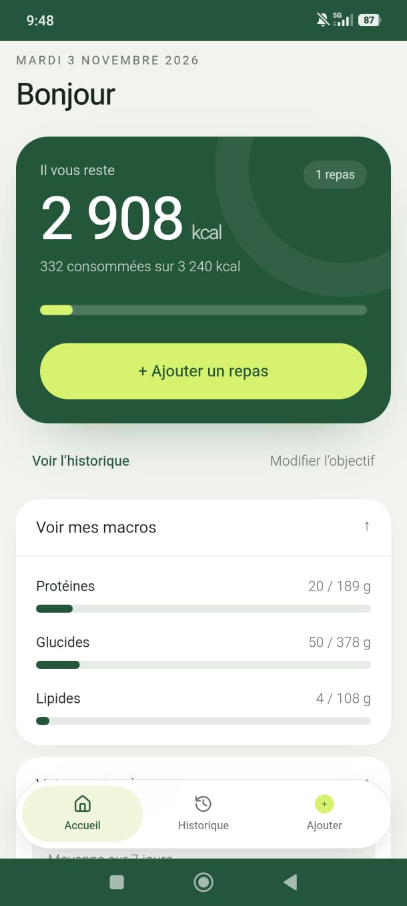
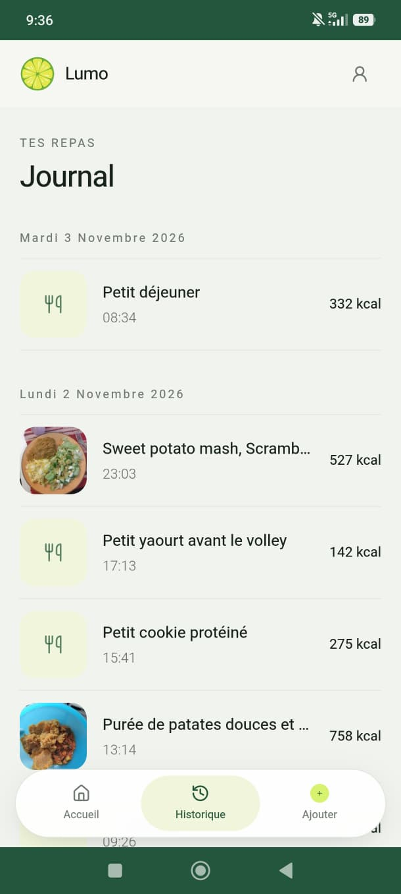
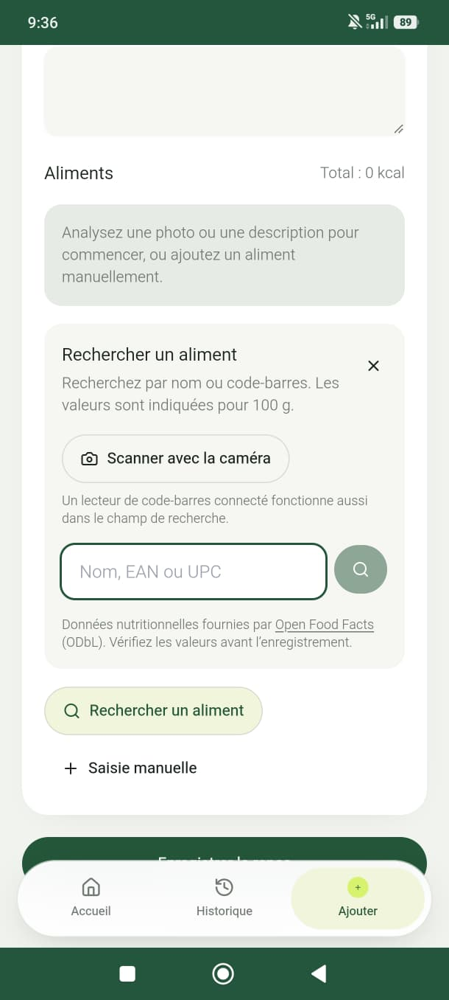
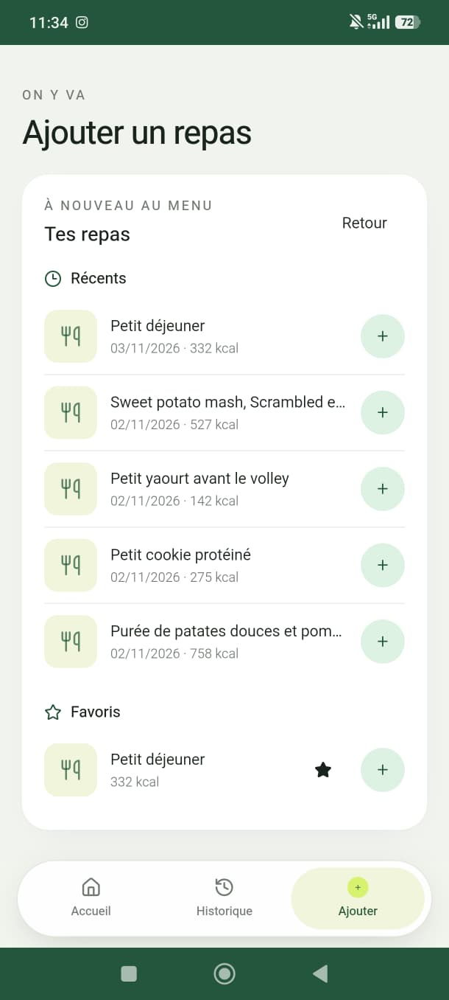
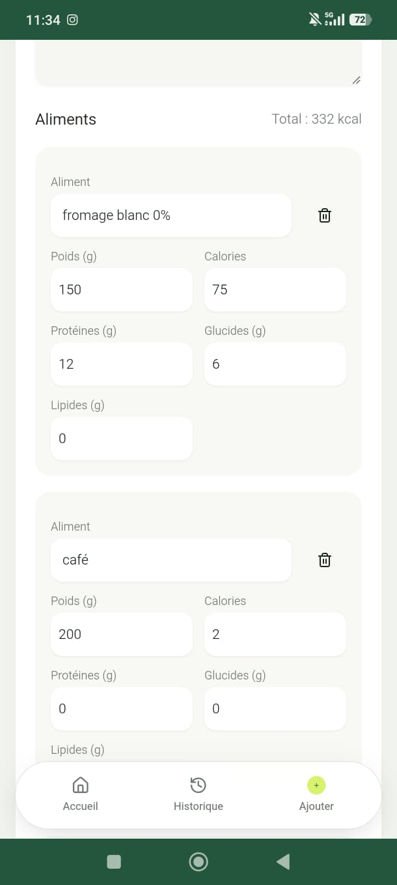
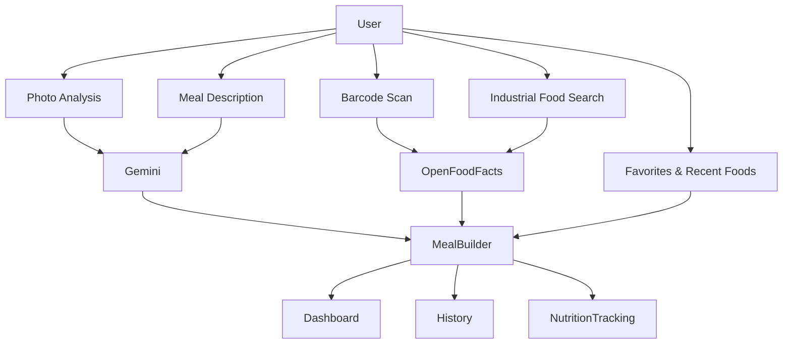
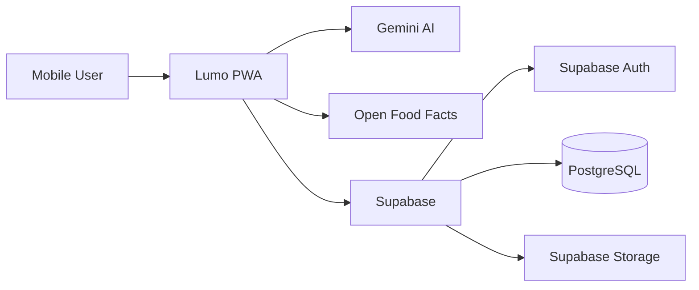

<p align="center">
  
</p>

<h1 align="center">Lumo</h1>

<p align="center">
  <strong>AI-powered nutrition tracking from photos, meal descriptions, barcode scans and favorite foods.</strong>
</p>

<p align="center">
  Track calories using the workflow that suits you best.
</p>

<p align="center">
  Analyze a meal from a photo, describe it in natural language, scan a barcode, search industrial foods or reuse your favorite foods.
</p>

<p align="center">
  Built for daily use, not as a tech demo.
</p>

<p align="center">
  
  
  
  
  
</p>

<p align="center">
  
</p>

<p align="center">
  <a href="https://calorie-tracker-ai-jet.vercel.app/">
    
  </a>
</p>

---

## Overview

Lumo is a mobile-first nutrition tracking Progressive Web App designed to reduce meal logging friction while preserving flexibility.

Instead of forcing users into a single workflow, Lumo allows meals to be created through:

- 📸 AI photo analysis
- ✍️ Natural language descriptions
- 📦 Barcode scanning
- 🔎 Industrial food search
- ⭐ Favorite and recent foods

Calories, macronutrients and nutrition goals are automatically calculated and tracked.

Lumo is actively maintained and used every day in real-world conditions.

---

## Highlights

- 📱 Mobile-first user experience
- 🤖 AI meal analysis powered by Gemini
- 📸 Photo-based food recognition
- ✍️ Natural language meal descriptions
- 📦 Barcode scanning with Open Food Facts
- 🔎 Industrial food search
- ⭐ Favorite and recent foods
- 📊 Daily calorie and macro tracking
- 🔐 Google OAuth and Supabase Auth
- 🚀 Production deployment on Vercel
- 📲 Android & iOS installable PWA

---

## Live Demo

🚀 Production URL

```text
https://calorie-tracker-ai-jet.vercel.app/
```

Create an account directly from the application.

---

## Screenshots

<p align="center">
  
  
  
</p>

<p align="center">
  
  
  
</p>

---

## Real-World Usage

Lumo is not a prototype.

The application is actively used on a daily basis for meal tracking, calorie management and nutrition monitoring.

The product continues to evolve based on real-world usage patterns and everyday feedback.

---

## Product Workflow



---

## Why Lumo?

Most nutrition tracking applications require repetitive manual food entry.

Lumo focuses on reducing logging friction by combining multiple complementary workflows inside a single mobile-first experience.

Users can simply choose the most convenient option:

- Photo analysis
- Natural language descriptions
- Barcode scanning
- Industrial food search
- Favorite foods

The goal is simple:

> **Spend less time entering meals and more time focusing on nutrition.**

---

## Technical Challenges

This project explores several real-world software engineering challenges:

- AI-powered meal recognition from images
- Natural language meal interpretation
- Nutrition estimation and macronutrient calculations
- Mobile-first product design
- Progressive Web App implementation
- Offline-first considerations
- Authentication and user management
- Database security through Row Level Security (RLS)
- Food data integration through Open Food Facts
- Performance optimisation for mobile devices
- Type-safe validation through Zod

---

## Architecture



---

## Technology Stack

| Area               | Technology                              |
| ------------------ | --------------------------------------- |
| Frontend           | Next.js 15, React 19, TypeScript        |
| UI                 | Tailwind CSS, shadcn/ui, Lucide         |
| State Management   | TanStack Query                          |
| Forms & Validation | React Hook Form, Zod                    |
| Backend            | Next.js Server Actions & Route Handlers |
| Database           | PostgreSQL (Supabase)                   |
| Authentication     | Supabase Auth & Google OAuth            |
| Security           | Row Level Security (RLS)                |
| AI                 | Gemini with OpenRouter fallback         |
| Food Data          | Open Food Facts                         |
| PWA                | next-pwa                                |
| Hosting            | Vercel                                  |

---

## Current Features

- AI meal analysis from photos
- AI meal analysis from natural language descriptions
- Barcode scanning
- Industrial food search
- Favorite foods
- Recent foods
- Daily calorie tracking
- Macronutrient tracking
- Meal history
- Goal management
- Google OAuth
- Email authentication
- Installable PWA

---

## Roadmap

### Short-Term

- [ ] Gallery photo import
- [ ] Improved offline experience
- [ ] Additional mobile performance optimisations
- [ ] Expanded automated testing

### Long-Term

- [ ] Advanced nutrition analytics
- [ ] Enhanced reporting
- [ ] Food recommendations
- [ ] Wearable integrations
- [ ] Broader offline capabilities

---

## Requirements

- Docker Engine with Docker Compose v2 for the quick start
- Alternatively, Node.js 22 LTS and npm for running without Docker (`nvm use` reads the pinned version)
- A Supabase project (hosted or local); this repository does not run Supabase in Docker
- A Gemini API key or an OpenRouter API key to use AI meal analysis

---

## Quick Start

```bash
git clone <repository-url>
cd calorie-tracker-ai
cp .env.example .env.local
```

Edit `.env.local` and provide `NEXT_PUBLIC_SUPABASE_URL` and
`NEXT_PUBLIC_SUPABASE_ANON_KEY` from your Supabase project. Set at least one of
`GEMINI_API_KEY` or `OPENROUTER_API_KEY` to enable meal analysis. These services
remain external; Compose starts only the Lumo application.

```bash
docker compose up
```

Open <http://localhost:3000>. The Compose service mounts the source tree and
keeps `node_modules` and Next.js build output in container volumes, so code
changes hot reload without replacing host files or installing Node.js locally.
Stop the service with `Ctrl+C` or `docker compose down`.

Useful shortcuts are also available: `npm run docker:up`,
`npm run docker:down` and `npm run docker:build`. Run `npm run check` for
TypeScript and ESLint checks.

### Environment variables

| Variable                        | Required                  | Purpose                                                                 |
| ------------------------------- | ------------------------- | ----------------------------------------------------------------------- |
| `NEXT_PUBLIC_APP_URL`           | Local default is provided | Application origin used for auth redirects and metadata                 |
| `NEXT_PUBLIC_SUPABASE_URL`      | Yes                       | Supabase project URL                                                    |
| `NEXT_PUBLIC_SUPABASE_ANON_KEY` | Yes                       | Supabase publishable/anon key; protected data access is enforced by RLS |
| `GEMINI_API_KEY`                | At least one AI key       | Server-side Gemini key; primary provider when both keys are set         |
| `OPENROUTER_API_KEY`            | At least one AI key       | Server-side fallback key, or the only provider if Gemini is unset       |
| `PERF_LOGS`                     | No                        | Enables server performance logs in production                           |
| `NEXT_PUBLIC_PERF_LOGS`         | No                        | Enables client performance logs in production                           |

`NEXT_PUBLIC_APP_VERSION` and `NEXT_PUBLIC_BUILD_DATE` are generated by the
Next.js configuration and do not need to be set manually. `VERCEL_URL` is
provided by Vercel when applicable. Open Food Facts has no API key requirement.

Do not commit `.env.local` or put AI API keys in `NEXT_PUBLIC_*` variables.
`.env.local` is excluded from Git and the Docker build context.

### Run without Docker

Install dependencies and use the same `.env.local` setup:

```bash
npm ci
npm run dev
```

---

## Supabase Configuration

### Hosted Project

```bash
npx supabase login
npx supabase link --project-ref <project-ref>
npx supabase db push
```

Configure the following callback URLs:

```text
http://localhost:3000/auth/callback
https://<production-domain>/auth/callback
```

### Local Supabase

```bash
npx supabase start
npx supabase migration up --local
```

Stop services:

```bash
npx supabase stop
```

---

## AI Provider Configuration

### Primary Provider

```text
GEMINI_API_KEY
```

Current model:

```text
gemini-3.1-flash-lite
```

### Fallback Provider

```text
OPENROUTER_API_KEY
```

Current model:

```text
google/gemini-2.0-flash-001
```

If both providers are configured, Gemini is used first and OpenRouter is used as fallback.

---

## Production Build

### Docker

Next.js embeds `NEXT_PUBLIC_*` values in the client bundle at build time. Pass
the public application and Supabase values as build arguments; never pass AI
secrets as build arguments:

```bash
docker build \
  --build-arg NEXT_PUBLIC_APP_URL=https://your-domain.example \
  --build-arg NEXT_PUBLIC_SUPABASE_URL=https://your-project.supabase.co \
  --build-arg NEXT_PUBLIC_SUPABASE_ANON_KEY=your-supabase-anon-key \
  --target runner \
  -t lumo .
docker run --rm -p 3000:3000 \
  -e GEMINI_API_KEY \
  -e OPENROUTER_API_KEY \
  lumo
```

Provide at least one AI key in the environment where the container runs.

### Node.js

```bash
npm run typecheck
npm run lint
npm run build
npm run start
```

---

## Deployment

### Vercel

1. Import the repository into Vercel.
2. Configure environment variables.
3. Deploy the project.
4. Add production callback URLs to Supabase Authentication.

Installable PWA functionality requires HTTPS.

---

## Source Layout

```text
src/
├── app/
├── components/
├── features/
├── hooks/
├── lib/
├── services/
├── types/
└── validators/

supabase/
├── migrations/
└── seed.sql
```

---

## License

**All rights reserved.**

No open-source license is granted.

You may not redistribute, modify or use this software without prior written permission from the copyright holder.
