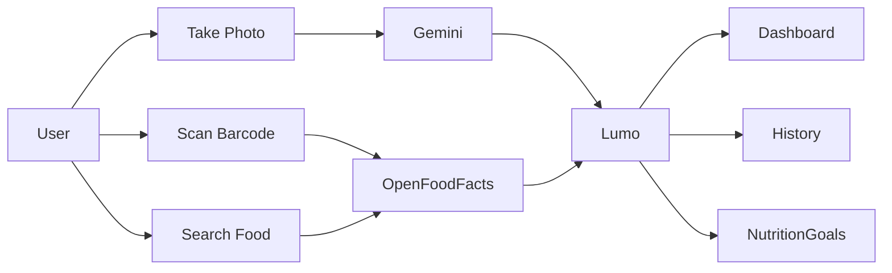
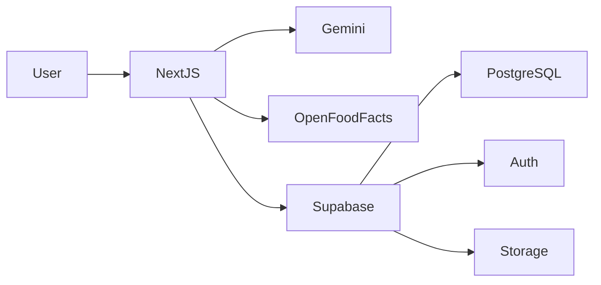

# Lumo

AI-powered nutrition tracking from photos, barcodes, text descriptions and favorite foods.

Lumo is a mobile-first Progressive Web App designed to reduce the friction of calorie tracking.

Users can log meals from a photo, a barcode scan, a food search, or previously saved favorites. The application automatically estimates calories and macronutrients, helping users stay aligned with their daily nutrition goals.

Built with Next.js, Supabase and Gemini. Used daily in production as a personal nutrition tracking application.

---

## Key Features

✅ AI meal analysis from photos

✅ Barcode scanning powered by Open Food Facts

✅ Food search and manual entry

✅ Favorite and recently used foods

✅ Daily calorie tracking

✅ Macronutrient tracking

✅ Meal history

✅ Google OAuth and email authentication

✅ Progressive Web App (PWA)

✅ Mobile-first user experience

---

## Screenshots

### Dashboard


### AI Meal Analysis


### Meal History


### Barcode Scanner


### Favorites & Recent Foods


---

## Product Workflow



---

## Why Lumo?

Most nutrition tracking applications require users to manually search for every food they consume.

Lumo focuses on reducing data entry effort by combining:

- AI-powered meal recognition
- Barcode scanning
- Smart food search
- Favorite food shortcuts
- Mobile-first workflows

The objective is simple: spend less time logging meals and more time focusing on nutrition.

---

## Technical Challenges

This project explores several real-world software engineering challenges:

- AI meal recognition and nutrition estimation
- Mobile-first product design
- Progressive Web App implementation
- Offline-first considerations
- Authentication and user management
- Database security with Row Level Security
- Food data integration via Open Food Facts
- Performance optimization on mobile devices
- Type-safe validation using Zod
- Production deployment on Vercel

---

## Architecture



---

## Technology Stack

| Area | Technology |
|--------|--------|
| Frontend | Next.js 15, React 19, TypeScript |
| UI | Tailwind CSS, shadcn/ui, Lucide |
| Forms & Validation | React Hook Form, Zod |
| State Management | TanStack Query |
| Backend | Next.js Server Actions |
| Database | PostgreSQL (Supabase) |
| Authentication | Supabase Auth, Google OAuth |
| Security | Row Level Security (RLS) |
| AI | Gemini, OpenRouter fallback |
| Food Data | Open Food Facts |
| PWA | next-pwa |
| Hosting | Vercel |

---

## Project Status

Lumo is actively maintained and used daily.

Current version includes:

- AI meal recognition
- Barcode scanning
- Meal history
- Favorites and recent foods
- PWA installation support
- Nutrition goal tracking

Upcoming improvements:

- Gallery import for food photos
- Improved offline support
- Advanced analytics
- Expanded automated testing

---

## Local setup

1. Clone the repository and install dependencies:

   ```bash
   git clone <repository-url>
   cd calorie-tracker-ai
   npm install
   ```

2. Create `.env.local` in the repository root:

   ```dotenv
   NEXT_PUBLIC_APP_URL=http://localhost:3000
   NEXT_PUBLIC_SUPABASE_URL=https://<project-ref>.supabase.co
   NEXT_PUBLIC_SUPABASE_ANON_KEY=<supabase-publishable-or-anon-key>

   # Configure at least one provider. If both are set, OpenRouter is the
   # fallback when the primary Gemini provider fails.
   GEMINI_API_KEY=<gemini-api-key>
   OPENROUTER_API_KEY=<openrouter-api-key>
   ```

   `GEMINI_API_KEY` and `OPENROUTER_API_KEY` are server-only secrets. Never
   prefix these values with `NEXT_PUBLIC_` or commit them. The Supabase
   publishable/anon key is intended for browser use; authorization is enforced
   by Supabase Auth and RLS.

3. Configure Supabase as described below, then start the development server:

   ```bash
   npm run dev
   ```

   Open [http://localhost:3000](http://localhost:3000). PWA service worker
   generation is disabled in development; verify installation behavior using a
   production build.

## Supabase configuration

### Hosted project

1. Create a Supabase project and copy its project URL and publishable/anon key
   into `.env.local`.
2. Apply the repository migrations in timestamp order. With the Supabase CLI:

   ```bash
   npx supabase login
   npx supabase link --project-ref <project-ref>
   npx supabase db push
   ```

   The migrations create the nutrition schema, access policies, dashboard
   functions, storage configuration, and reusable-meal tables. Do not execute
   a migration a second time manually after it has already been applied.

3. In **Authentication → URL Configuration**, set the Site URL to
   `http://localhost:3000` for local work and add the production application
   URL. Add the OAuth callback URL:

   ```text
   http://localhost:3000/auth/callback
   https://<production-domain>/auth/callback
   ```

4. To enable Google sign-in, configure the Google provider in Supabase Auth and
   register Supabase's OAuth callback URL in Google Cloud:

   ```text
   https://<project-ref>.supabase.co/auth/v1/callback
   ```

   Also configure the allowed redirect URLs in Supabase.

### Local Supabase (optional)

The repository includes `supabase/config.toml` and a seed file. With Docker and
the Supabase CLI installed, start the local stack and apply migrations:

```bash
npx supabase start
npx supabase migration up --local
```

Use the local API URL and anon key printed by the CLI in `.env.local`. Stop the
local services with `npx supabase stop`.

## AI provider configuration

Configure at least one server-side key:

- `GEMINI_API_KEY`: primary provider; currently uses
  `gemini-3.1-flash-lite`.
- `OPENROUTER_API_KEY`: OpenRouter provider; currently uses
  `google/gemini-2.0-flash-001`.

When both are configured, Lumo tries Gemini first and falls back to OpenRouter
on provider failure. AI credentials are read only by server-side code in
`src/services/ai/`.

## Production build

```bash
npm run typecheck
npm run lint
npm run build
npm run start
```

The production server is available at [http://localhost:3000](http://localhost:3000).
The PWA plugin generates `public/sw.js` and related Workbox assets during
production builds; treat those files as generated output rather than editing
them by hand.

## Vercel deployment

1. Import the repository into Vercel and select the Next.js framework
   preset. The standard `npm run build` command is used by the project.
2. Add these environment variables to the Vercel environments where they are
   needed:

   ```text
   NEXT_PUBLIC_APP_URL=https://<production-domain>
   NEXT_PUBLIC_SUPABASE_URL=https://<project-ref>.supabase.co
   NEXT_PUBLIC_SUPABASE_ANON_KEY=<supabase-publishable-or-anon-key>
   GEMINI_API_KEY=<gemini-api-key>
   OPENROUTER_API_KEY=<openrouter-api-key>
   ```

   At least one AI key is required for meal analysis. Add the production
   domain, including `/auth/callback`, to Supabase's allowed redirect URLs.

3. Deploy. Installable PWA behavior requires HTTPS; Vercel provides HTTPS for
   deployed domains.
4. On iOS, open the deployed site in Safari and use **Share → Add to Home
   Screen**. On Android, install from the browser's install prompt or menu.

## PWA identity and updates

The web app manifest is generated by `src/app/manifest.ts`; browser, Open Graph,
and Apple web app metadata live in `src/app/layout.tsx`. Icons are in
`public/icons/`. The Profile → Application section displays the build version,
checks the registered service worker for an update, and provides platform
specific reinstall instructions.

Mobile operating systems can retain an installed app's name and icon from its
original installation. If an updated icon or name does not appear after a
deployment, update/reload the service worker first. If the launcher still shows
the old branding, remove the old home-screen installation and install Lumo
again from the current HTTPS site. Removing the shortcut does not remove the
user's Supabase account or saved meals.

## Source layout

```text
src/
├── app/          App Router pages, metadata, manifest, and API route handlers
├── components/   Shared UI and feature-specific React components
├── features/     Auth, dashboard, goals, history, and meal actions/queries
├── hooks/        Shared React hooks
├── lib/          Supabase clients, auth helpers, and performance utilities
├── services/     AI providers and food lookup integrations
├── types/        TypeScript and database types
└── validators/   Zod schemas for request and form validation

supabase/
├── migrations/   PostgreSQL schema, functions, storage, and RLS policies
└── seed.sql      Local development seed data
```

## Development roadmap

- [ ] Add product screenshots and a short installation walkthrough.
- [ ] Complete authenticated mobile performance measurements for common
      navigation paths.
- [ ] Validate app name and icon updates across current Android and iOS
      versions.
- [ ] Evaluate broader offline support and cache behavior with explicit
      privacy and freshness requirements.
- [ ] Expand automated coverage for meal reuse and portion adjustment.

## License

**All rights reserved.** No open-source license is granted. You may not
redistribute, modify, or use this software without prior written permission
from the copyright holder.
